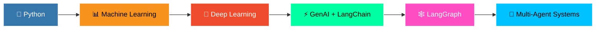

<div align="center">



<a href="https://github.com/yogeshsikhwal77">
  
</a>

<br/><br/>


<br/>


<br/><br/>

<a href="https://www.linkedin.com/in/yogesh-sikhwal-0198753b3"></a>
<a href="mailto:yogeshsikhwal77@example.com"></a>
<a href="https://github.com/yogeshsikhwal77"></a>

</div>


##  About Me

<table>
<tr>
<td width="60%" valign="top">

```js
const yogesh = {
  college : "IIT Jodhpur · B.Tech Chemical Engineering (2nd yr)",
  path    : "Python → ML → Deep Learning → GenAI → Agents",
  building: ["RAG assistants", "LLM training pipelines", "full-stack apps"],
  learning: ["LangGraph", "multi-agent systems"],
  grinding: "DSA in C++ (competitive programming)",
  goal    : "AI/ML internship + open-source GenAI",
  fun     : ["video games 🎮", "weird movies 🎬"],
};
```

</td>
<td width="40%" align="center" valign="middle">


</td>
</tr>
</table>


## 🔥 Featured Projects

<div align="center">

<a href="https://github.com/yogeshsikhwal77/nanoGPT"></a>
<a href="https://github.com/yogeshsikhwal77/SpectraFi"></a>
<br/>
<a href="https://github.com/yogeshsikhwal77/AutoDataCleaner"></a>
<a href="https://github.com/yogeshsikhwal77/ICS-Project"></a>

</div>

<details>
<summary><b>📖 Click for project details</b></summary>
<br/>

| Project | What it does | Stack |
|---|---|---|
| 🧠 **nanoGPT** | End-to-end custom LLM pipeline: pretraining (15M / 33M params), SFT, DPO, and a Dockerized inference API | `PyTorch` `FastAPI` `Docker` |
| 📈 **SpectraFi** | Multi-modal RAG assistant that chats with financial PDFs and understands text, charts and tables via Gemini vision | `LangChain` `Gemini` `ChromaDB` `Streamlit` |
| 🧹 **AutoDataCleaner** | Automated data-cleaning pipeline | `Pandas` `NumPy` |
| 🗂️ **ICS-Project** | File-handling system for students and teachers | `C` |

</details>


## 🛠️ Tech Arsenal

<div align="center">


<br/>

<br/>

<br/>


<br/>


</div>


## 📊 GitHub Analytics

<div align="center">


<br/>


<br/>


</div>


## 🐍 Contribution Snake

<div align="center">

<picture>
  <source media="(prefers-color-scheme: dark)" srcset="https://raw.githubusercontent.com/yogeshsikhwal77/yogeshsikhwal77/output/github-snake-dark.svg"/>
  <source media="(prefers-color-scheme: light)" srcset="https://raw.githubusercontent.com/yogeshsikhwal77/yogeshsikhwal77/output/github-snake.svg"/>
  
</picture>

</div>


## 🧭 Learning Roadmap



<div align="center">

<br/>


<br/>

*Let's build something cool together.* 🤝



</div>
